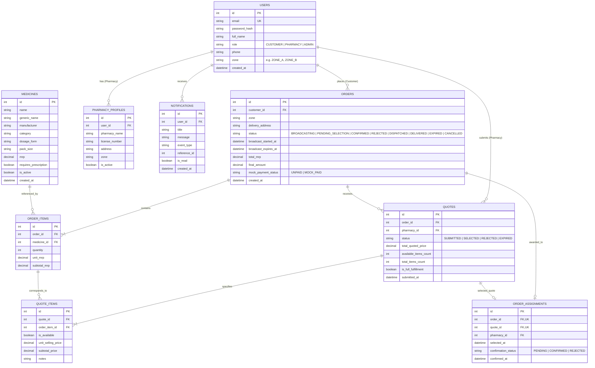

# Tapza Pharmacy Management & Medicine Ordering MVP — Architecture Specification

## 1. System Overview

Tapza is an on-demand full-stack medicine ordering and pharmacy management platform designed for multi-pharmacy competitive quoting and localized fulfillment.

The platform connects three primary actors:
- **Customers**: Search an authorized medicine catalogue, build carts, checkout, broadcast orders to eligible local pharmacies, compare item-level quotes within a strictly enforced 4-minute window, select a single winning pharmacy, and track fulfillment status.
- **Pharmacies**: Maintain zone eligibility, receive real-time order broadcasts within their designated zone, submit full or partial quotes with item-level pricing and availability guarantees, receive winning order allocations, and accept/reject and dispatch orders.
- **Admins**: Manage users, onboard and verify pharmacies, maintain and import validated medicine catalogues (via Excel/CSV), oversee platform order broadcasts, and review audit/activity logs.

---

## 2. Technical Stack

| Tier | Technology | Purpose |
| :--- | :--- | :--- |
| **Frontend** | React Native (Expo SDK 51+), TypeScript | Cross-platform mobile and web client |
| **Navigation & Routing** | Expo Router (File-based routing) | Deep linking, typed route groups `(customer)`, `(pharmacy)`, `(admin)`, `(auth)` |
| **Web Support** | Expo Web (`react-native-web`) | Desktop browser responsiveness for admin & pharmacy dashboards |
| **State & Networking** | React Context + Axios / Fetch API | Global auth context, shopping cart state, real-time polling |
| **Backend** | Python 3.10+ / Flask | Lightweight, deterministic RESTful API |
| **Database** | SQLite 3 with Write-Ahead Logging (WAL) | ACID-compliant relational persistence, transaction locks |
| **Data Validation** | Pydantic / Marshmallow & openpyxl | Request validation and validated Excel catalogue import |
| **Authentication** | JWT (JSON Web Tokens) + PBKDF2 / bcrypt | Role-based token access, salted password hashing |

---

## 3. Architecture & Folder Structure

```
sharp-volta/
├── backend/
│   ├── app/
│   │   ├── __init__.py          # Flask application factory, CORS, DB initialization
│   │   ├── config.py            # Environment configurations (JWT secrets, timeouts, DB URI)
│   │   ├── db.py                # Database connection helper with WAL & transactional context managers
│   │   ├── models/              # Relational schema definitions & dataclasses
│   │   │   ├── __init__.py
│   │   │   ├── user.py          # Customer, Pharmacy, Admin entities
│   │   │   ├── medicine.py      # Medicine catalogue & batch metadata
│   │   │   ├── order.py         # Orders & OrderItems
│   │   │   ├── quote.py         # Quotes & QuoteItems
│   │   │   └── notification.py   # Persisted user notifications
│   │   ├── routes/              # Modular blueprint endpoints
│   │   │   ├── __init__.py
│   │   │   ├── auth_routes.py   # Signup, Login, Profile, Role guards
│   │   │   ├── medicine_routes.py # Search, catalogue CRUD, Excel batch import
│   │   │   ├── order_routes.py  # Create order, broadcast lifecycle, status updates
│   │   │   ├── quote_routes.py  # Pharmacy quote submission, customer quote comparison
│   │   │   ├── selection_routes.py # Atomic single-pharmacy quote selection
│   │   │   ├── pharmacy_routes.py  # Incoming broadcasts, accepted orders, dispatch
│   │   │   └── admin_routes.py  # User management, order monitoring, catalog analytics
│   │   ├── services/            # Core business logic
│   │   │   ├── broadcast_service.py # 4-minute window calculations and expiry triggers
│   │   │   ├── selection_service.py # Concurrency-protected single selection transaction
│   │   │   ├── pricing_service.py   # Partial quote calculation (MRP vs selling price)
│   │   │   ├── import_service.py    # Validated Excel parsing & sanitization
│   │   │   └── notification_service.py # Event-driven persistent alerts
│   │   └── utils/
│   │       ├── auth_helpers.py  # JWT generation, token required decorators
│   │       └── validators.py    # Input schema validators
│   ├── instance/
│   │   └── tapza.db             # Fresh SQLite database file
│   ├── requirements.txt         # Backend Python dependencies
│   └── run.py                   # Development server entry point
│
├── frontend/
│   ├── app/                     # Expo Router file structure
│   │   ├── _layout.tsx          # Root provider layout (Auth, Theme, Notification toast)
│   │   ├── index.tsx            # Splash / Entry redirect based on role
│   │   ├── (auth)/
│   │   │   ├── _layout.tsx
│   │   │   ├── login.tsx        # Unified login screen with role redirection
│   │   │   └── register.tsx     # Customer and Pharmacy onboarding
│   │   ├── (customer)/
│   │   │   ├── _layout.tsx      # Customer tab / stack navigator
│   │   │   ├── index.tsx        # Medicine catalogue search & browsing
│   │   │   ├── cart.tsx         # Cart review, quantity adjust, delivery address/zone
│   │   │   ├── checkout.tsx     # Order creation & broadcast initiation
│   │   │   ├── orders/
│   │   │   │   ├── index.tsx    # Order history & ongoing active broadcasts
│   │   │   │   └── [id].tsx     # Real-time 4-min countdown, quote comparison, selection
│   │   │   └── notifications.tsx
│   │   ├── (pharmacy)/
│   │   │   ├── _layout.tsx      # Pharmacy tab navigator
│   │   │   ├── broadcasts.tsx   # Active incoming zone broadcasts with 4-min timer
│   │   │   ├── quote/[id].tsx   # Item availability toggle & pricing quote form
│   │   │   ├── orders.tsx       # Won orders pending confirmation, preparation, dispatch
│   │   │   └── profile.tsx      # Zone setting, pharmacy license, contact
│   │   ├── (admin)/
│   │   │   ├── _layout.tsx      # Admin dashboard layout
│   │   │   ├── dashboard.tsx    # Order volume, active broadcasts, pharmacy distribution
│   │   │   ├── medicines.tsx    # Catalogue manager & Excel import upload tool
│   │   │   ├── pharmacies.tsx   # Pharmacy verification & zone assignments
│   │   │   └── orders.tsx       # Global order audit trail
│   ├── components/              # Modular UI components
│   │   ├── Badge.tsx            # Status pills (Broadcasting, Quoted, Won, Dispatched)
│   │   ├── CountdownTimer.tsx   # Synchronized 4-minute broadcast countdown widget
│   │   ├── MedicineCard.tsx     # Medicine item presentation with MRP display
│   │   ├── QuoteCard.tsx        # Quote comparison card with partial fulfillment indicators
│   │   └── MockPaymentModal.tsx # Simulated mock payment modal with clear labelling
│   ├── constants/
│   │   ├── Colors.ts            # Brand colors, status alert colors
│   │   └── Config.ts            # API base URL and timeouts
│   ├── context/
│   │   ├── AuthContext.tsx      # User session, JWT persistence, role routing
│   │   └── CartContext.tsx      # Client-side cart item storage
│   ├── services/
│   │   ├── api.ts               # Axios / Fetch client with bearer token interceptor
│   │   └── endpoints.ts         # Endpoint definitions
│   ├── types/
│   │   └── index.ts             # TypeScript interfaces for Medicine, Order, Quote, User
│   ├── package.json
│   ├── tsconfig.json
│   └── app.json
│
└── docs/
    └── ARCHITECTURE.md          # Comprehensive specification document
```

---

## 4. Domain Model & Database Schema

The SQLite database uses `PRAGMA foreign_keys = ON;` and `PRAGMA journal_mode = WAL;` to support concurrent readers and serialized atomic writers.



---

## 5. Core Business Workflows & Critical Constraints

### 5.1 The 4-Minute Broadcast Window
1. When a Customer places an order, the backend sets:
   - `broadcast_started_at = NOW()`
   - `broadcast_expires_at = NOW() + 240 seconds` (strictly 4 minutes).
2. The remaining time is derived dynamically by the backend: `max(0, broadcast_expires_at - NOW())`.
3. Eligible Pharmacies in the customer's matching zone receive this broadcast.
4. If a pharmacy submits a quote after `NOW() > broadcast_expires_at`, the backend rejects the submission with HTTP `410 Gone` ("Broadcast window has closed").
5. The customer can review quotes in real time during the 4-minute window. When the window expires, order state transitions to `PENDING_SELECTION` (if quotes exist) or `EXPIRED` (if 0 quotes were received).

### 5.2 Atomic Single-Pharmacy Selection & Concurrency Protection
To prevent duplicate assignment, race conditions, or double-selection:
1. Selection is executed inside an **isolated database transaction** (`BEGIN IMMEDIATE` in SQLite).
2. The selection service checks:
   - Order exists and belongs to the calling Customer.
   - Order `status` is currently `BROADCASTING` or `PENDING_SELECTION`.
   - No row exists in `ORDER_ASSIGNMENTS` for this `order_id`.
3. If valid:
   - Insert row into `ORDER_ASSIGNMENTS` (`order_id`, `quote_id`, `pharmacy_id`, `selected_at`).
   - Update `ORDERS` status to `CONFIRMED_PENDING_PHARMACY` (or `CONFIRMED`).
   - Update winning `QUOTES` status to `SELECTED`.
   - Update all other quotes for this order to `REJECTED`.
   - Recalculate payable order amount based strictly on winning quote's available items.
   - Insert notifications for both Customer and Pharmacy.
   - Commit transaction.
4. Any concurrent or subsequent selection attempt fails with HTTP `409 Conflict` ("Order has already been assigned to a pharmacy").

### 5.3 Partial Availability, Item-Level Pricing & MRP Preservation
1. Each quote captures item-by-item status:
   - `is_available` (Boolean)
   - `unit_selling_price` (Decimal, compared against original `unit_mrp`)
   - `subtotal_price` = `quantity * unit_selling_price` (if available) or `0.00` (if unavailable).
2. **Strict Pricing Rule**: Never charge for unavailable medicines. If an item is unavailable in a partial quote:
   - It is flagged with `is_available = False`.
   - Subtotal for that item is strictly `0.00`.
   - It is visually struck out in customer view with clear itemization: "Unavailable - Not Charged".
3. The original MRP is permanently preserved in `ORDER_ITEMS.unit_mrp` for clear customer price transparency and savings calculation.

### 5.4 Pharmacy Order Acceptance & Dispatch
1. Upon assignment, the selected pharmacy receives a priority alert.
2. The pharmacy can inspect the exact items they quoted and click **Confirm Order** or **Reject Order**.
3. If confirmed, status becomes `CONFIRMED` -> `PREPARING` -> `DISPATCHED` -> `DELIVERED`.
4. If rejected by the pharmacy, customer is notified immediately to choose an alternative quote or cancel.

### 5.5 Mock Payment
- Payment is simulated via a dedicated UI modal and backend mock endpoint.
- Clear visual badge: **"Simulated Test Payment (Mock)"**.
- Updates `mock_payment_status = 'MOCK_PAID'`.

---

## 6. API Route Specification

| Blueprint | Method | Path | Role | Description |
| :--- | :--- | :--- | :--- | :--- |
| **Auth** | `POST` | `/api/auth/register` | Public | Register customer or pharmacy |
| | `POST` | `/api/auth/login` | Public | Authenticate and obtain JWT |
| | `GET` | `/api/auth/me` | Authenticated | Get current user profile and role |
| **Medicines**| `GET` | `/api/medicines` | Public/Auth | Search & list active catalogue medicines |
| | `POST` | `/api/medicines` | Admin | Add individual medicine |
| | `POST` | `/api/medicines/import` | Admin | Validated Excel (`.xlsx`) catalogue import |
| **Orders** | `POST` | `/api/orders` | Customer | Create order and initiate 4-min broadcast |
| | `GET` | `/api/orders/my-orders`| Customer | List customer orders |
| | `GET` | `/api/orders/<id>` | Customer/Admin| Get order details, items, timer & quotes |
| **Quotes** | `GET` | `/api/pharmacy/broadcasts`| Pharmacy | List active order broadcasts in pharmacy zone |
| | `POST` | `/api/quotes` | Pharmacy | Submit full or partial quote within timer |
| | `POST` | `/api/orders/<id>/select`| Customer | Concurrency-protected single quote selection |
| **Fulfillment**| `POST` | `/api/pharmacy/orders/<id>/confirm`| Pharmacy | Accept or reject assigned order |
| | `POST` | `/api/pharmacy/orders/<id>/status` | Pharmacy | Update order status (Dispatch/Deliver) |
| **Admin** | `GET` | `/api/admin/metrics` | Admin | Summary counts (orders, quotes, pharmacies) |
| | `GET` | `/api/admin/pharmacies` | Admin | List all pharmacies and approval statuses |
| | `POST` | `/api/admin/pharmacies/<id>/toggle`| Admin | Activate/deactivate pharmacy |
| **Notifications**| `GET` | `/api/notifications` | Authenticated | List user notifications |
| | `POST` | `/api/notifications/<id>/read` | Authenticated | Mark notification as read |

---

## 7. Stage-by-Stage Implementation Roadmap

1. **Stage 1**: Create folder structure and document architecture *(Completed)*.
2. **Stage 2**: Implement database schema, migrations, connection management, password hashing, and JWT authentication.
3. **Stage 3**: Implement medicine catalogue, search endpoints, and validated Excel import.
4. **Stage 4**: Build customer catalogue search, cart management, and checkout broadcast flow.
5. **Stage 5**: Build zone broadcast distribution and pharmacy quotation interface with 4-minute timer enforcement.
6. **Stage 6**: Build atomic single-pharmacy quote selection with concurrency protection and partial fulfillment pricing.
7. **Stage 7**: Implement pharmacy order management (acceptance, rejection, dispatch) and notification persistence.
8. **Stage 8**: Build admin dashboards, pharmacy verification, and catalogue oversight.
9. **Stage 9**: End-to-end integration testing, race condition stress tests, and security validation.
10. **Stage 10**: Complete deployment and local setup instructions.
